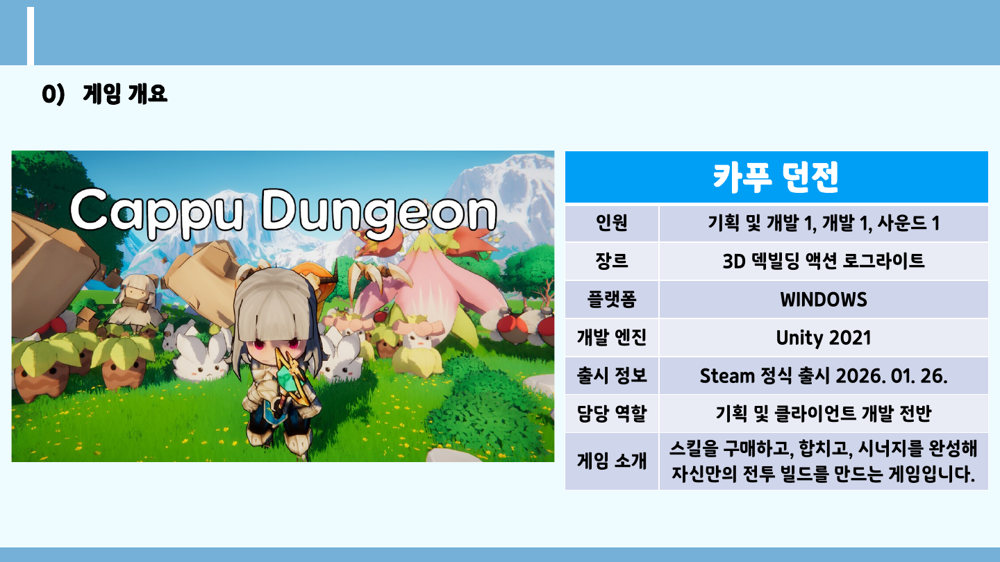
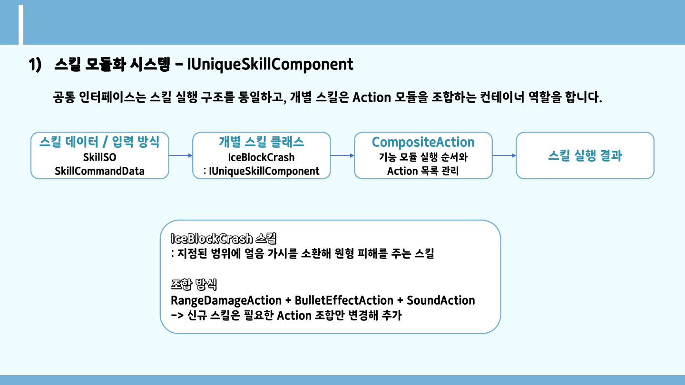
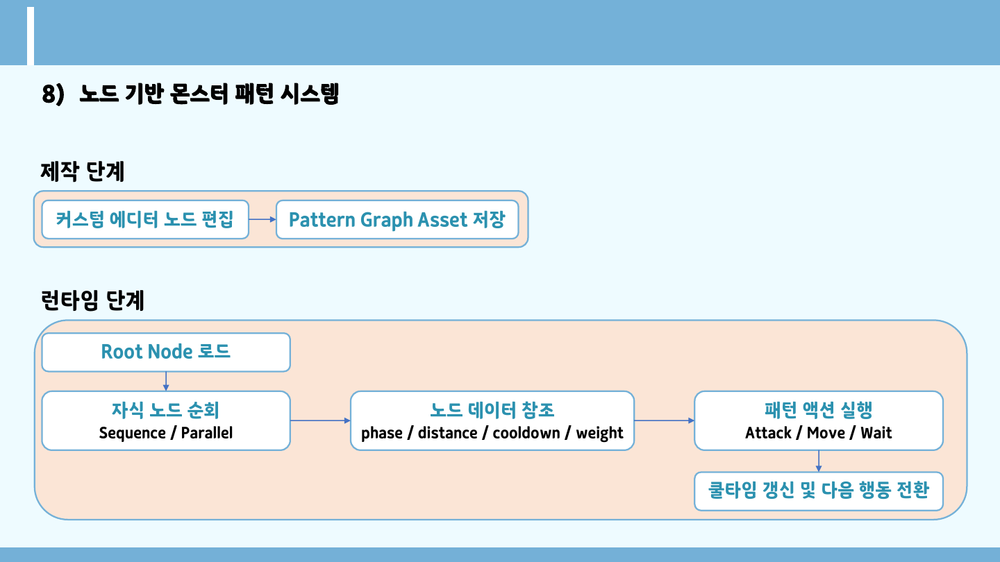

# 카푸 던전 (Cappu Dungeon)

**3D 덱빌딩 액션 로그라이트 | Unity 2021 | Windows | Steam 정식 출시 2026.01.26**

스킬 카드를 구매하고 합쳐 자신만의 전투 빌드를 만드는 게임입니다. 3인 팀에서 **기획 및 클라이언트 개발 전반**을 담당했습니다.

> 📄 **[카푸 던전 개발 포트폴리오 전체 보기 (PDF · 52페이지)](./portfolio/Cappu_Dungeon_Portfolio.pdf)**  
> 🎬 **[공식 트레일러 (YouTube)](https://www.youtube.com/watch?v=d0scGXJc0s4)** · [스킬 소개 (Notion)](https://www.notion.so/262f15e077a98056a91be2ebcf1164b2?source=copy_link)

## 포트폴리오 미리보기

아래 이미지를 클릭하면 전체 PDF가 열립니다.

| 게임 개요 | 스킬 모듈화 아키텍처 | 노드 기반 몬스터 패턴 |
| :---: | :---: | :---: |
|  |  |  |
| 게임 소개 · 담당 역할 | 인터페이스 · 액션 조합 | 에디터 · 런타임 실행 |

## 개발 포트폴리오 주요 내용

전체 PDF에서 문제 상황, 설계 목표, 구현 방식, 실행 결과를 다룹니다.

| 주제 | 핵심 내용 |
| --- | --- |
| 01. 스킬 모듈화 | `IUniqueSkillComponent`와 Action 조합을 통한 스킬 확장 |
| 02. 특성 시스템 - SO 조합 | 발동 조건(Invoker)과 효과(Effect) 모듈의 데이터 기반 구성 |
| 03. 특성 시스템 - 이벤트 | 장착·교체·해제 시 이벤트 구독 수명 관리 |
| 04. 레벨 기반 상태이상 | 중첩 레벨 카운트 및 저항 수치 비교 |
| 05. 스킬 머지 | 동일 카드 합성 후 카드·슬롯·전투 연출 상태 동기화 |
| 06. 오브젝트 풀링 | Addressables 비동기 로드 및 타입·ID별 재사용 큐 |
| 07. 몬스터 패턴 선택 | 조건과 가중치를 이용한 패턴 결정 |
| 08. 노드 기반 몬스터 패턴 | 커스텀 노드 에디터, 순차·병렬 액션 실행 |
| 09. 셰이더 | 피격·사망 시각 효과 |
| 10. 유저 데이터 저장·로드 | 플레이 데이터 영속화 |
| 11. 이벤트 기반 튜토리얼 | 게임 이벤트에 따른 튜토리얼 단계 제어 |
| 12. Excel 밸런스 자동화 | 데이터 수정·동기화 작업 자동화 |

## 구현 코드 및 영상

### 노드 기반 몬스터 패턴 시스템

패턴 로직은 코드로 정의하되, 노드 기반 커스텀 에디터에서 조합해 동시·순차 발동 흐름을 구성하고 `ScriptableObject`로 저장할 수 있도록 구축했습니다.

**관련 코드:** [PatternNode.cs](./PatternNode.cs) · [EnemyPattern.cs](./EnemyPattern.cs) · [MeleePattern.cs](./MeleePattern.cs)

**Flame Spirit 몬스터 패턴 시연 영상**

https://github.com/user-attachments/assets/23f4a9f7-eb8b-40f5-b625-e35c80688e04

### 어드레서블 기반 제네릭 오브젝트 풀

`AddressableObjectPool<T>`로 비동기 로드 → 인스턴스화 → 큐 재사용 흐름을 구성하고, `EnemyAdrObjPool`에서 적 스폰·반납과 보스 시작 처리 등 게임 로직에 맞게 확장했습니다.

**관련 코드:** [AddressableObjectPool.cs](./AddressableObjectPool.cs) · [EnemyAdrObjPool.cs](./EnemyAdrObjPool.cs)

### 유니크 스킬 아키텍처

`IUniqueSkillComponent` 인터페이스와 `UniqueSkillComponentBase`를 통해 스킬 실행 타입, 입력 액션, 대기 동작, 이펙트 레벨, 슬롯 UI 연동을 모듈화했습니다. `FlameBreath`(방향 지정)와 `Blizzard`(범위 지정)는 이펙트·사운드 로드와 피해 액션 조합을 보여 줍니다.

**관련 코드:** [IUniqueSkillComponent.cs](./IUniqueSkillComponent.cs) · [UniqueSkillComponentBase.cs](./UniqueSkillComponentBase.cs) · [FlameBreath.cs](./FlameBreath.cs) · [Blizzard.cs](./Blizzard.cs)

**FlameBreath 스킬 시연 영상**

https://github.com/user-attachments/assets/9363f5a9-5fed-4f4b-b994-453972e69e14
**Blizzard 스킬 시연 영상**

https://github.com/user-attachments/assets/42f0b5e7-1907-4b29-8af6-830e3868fe2c

### 스킬 발동 방식

- **다운:** 키를 누를 때 발동
- **업:** 키를 놓을 때 발동 (기획 변경으로 현재는 다운 방식으로 통일)
- **일반:** 캐릭터 주변 / **방향:** 마우스 방향 / **범위:** 마우스 지정 위치

---

보다 자세한 설계 의도와 실행 결과는 **[개발 포트폴리오 PDF](./portfolio/Cappu_Dungeon_Portfolio.pdf)**에 정리했습니다.
